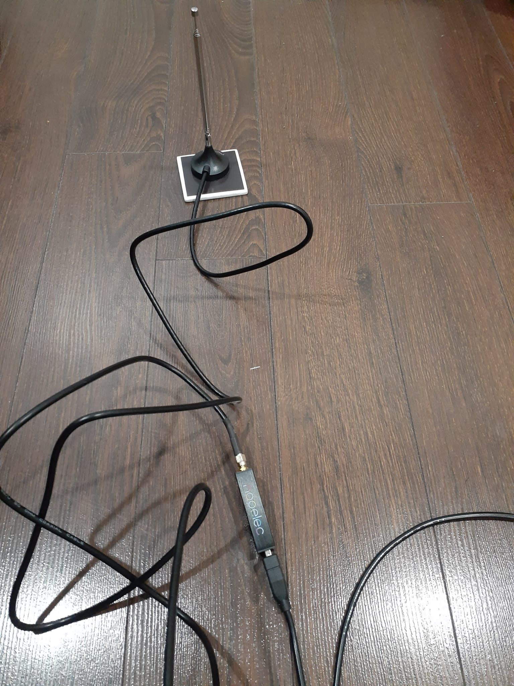
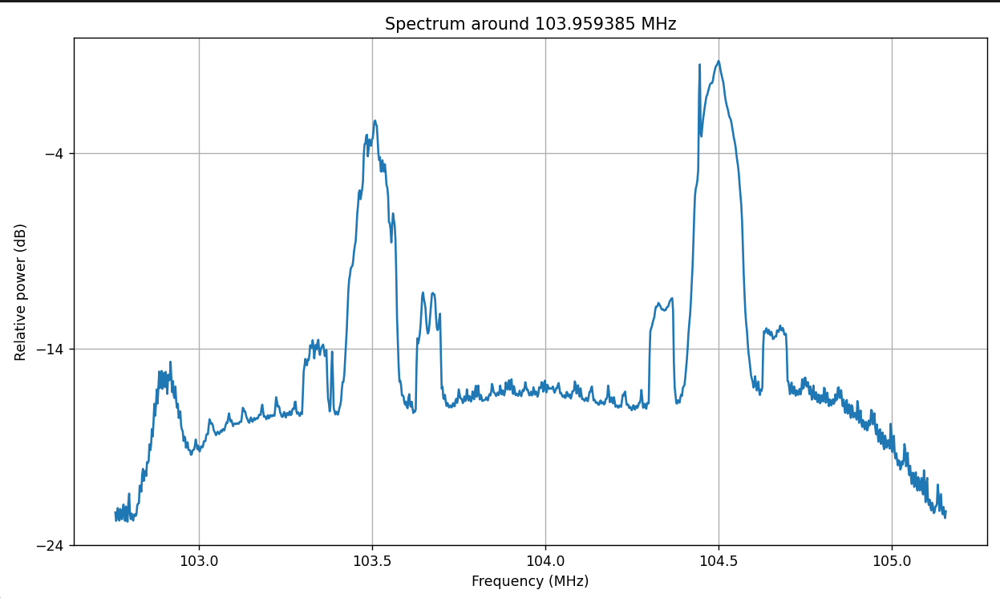
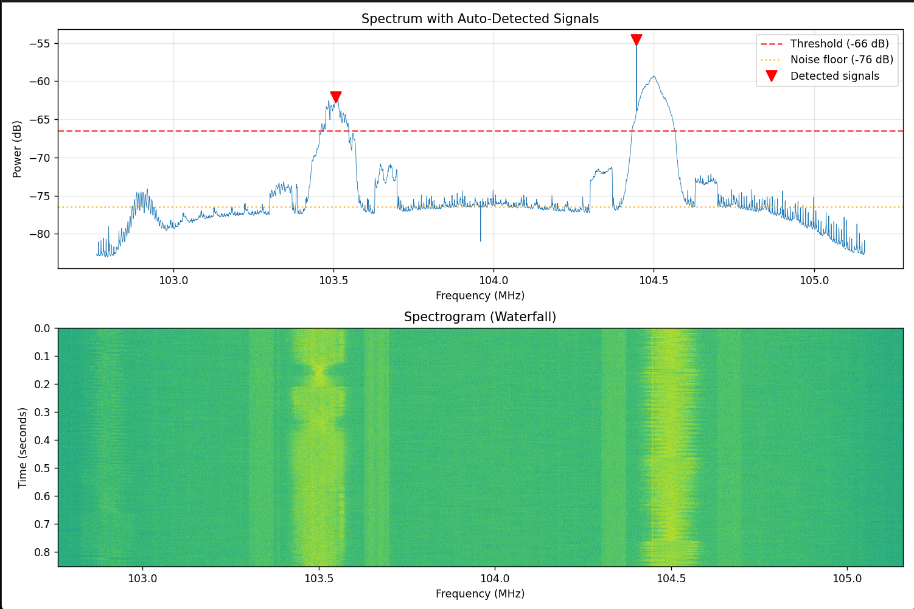
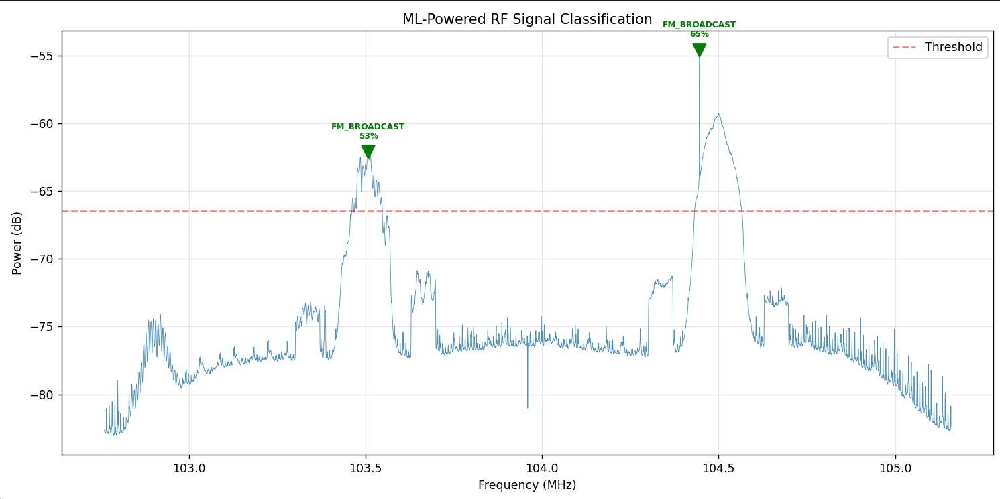

# RTL-SDR Drone RF Threat Detection System

A software-defined radio (SDR) pipeline that captures RF signals, detects and classifies them using machine learning, matches them against a database of known drone communication profiles, and produces threat assessment reports. Built around a low-cost RTL-SDR dongle.

This project monitors the sub-GHz ISM bands (433/868/915 MHz) where drone telemetry and control links operate, identifying potential unauthorized drone activity through RF signal intelligence.

## Overview

The system runs a full signal-intelligence pipeline:

1. **Capture** — ingest IQ samples from an RTL-SDR recording
2. **Detect** — automatically find signals above the noise floor
3. **Classify** — identify signal type using a trained Random Forest model
4. **Fingerprint** — match against known drone RF profiles (SiK, Crossfire, ExpressLRS, FrSky)
5. **Assess** — score each signal for drone-related threat using multiple risk factors
6. **Report** — generate timestamped JSON and text security assessment reports

## Hardware

This project was built and tested with the following hardware:



| Component | Detail |
|-----------|--------|
| **SDR dongle** | NooElec NESDR SMArt v5 (RTL2832U chipset + R820T2 tuner) |
| **Frequency range** | ~24 MHz – 1.7 GHz |
| **Antenna** | Telescoping antenna (adjustable length for different bands) |
| **Antenna base** | Magnetic mount base with coaxial cable (SMA) |
| **Connection** | USB 2.0 cable (dongle to host PC) |
| **Host OS** | Windows |
| **Capture software** | SDR++ (for IQ recording) |

The telescoping antenna mounts on the magnetic base, which connects to the dongle via the coaxial cable. The dongle connects to the PC over USB. Recordings are captured in SDR++ as baseband IQ WAV files and analyzed offline by this pipeline.

> **Note on frequency coverage:** The RTL-SDR tuner range covers the 433/868/915 MHz drone telemetry bands. It does **not** reach 2.4 GHz / 5.8 GHz, where DJI OcuSync and similar video links operate — those profiles are included in the database for reference but flagged as not RTL-SDR detectable.

## Screenshots

### Real-world signal capture
FM broadcast spectrum captured from the RTL-SDR and processed in Python — two stations clearly visible at ~103.5 and ~104.5 MHz:



### Automatic signal detection
The detector finds signals above the noise floor (red triangles); the spectrogram below shows their persistence over time:



### ML classification
The trained Random Forest model classifies each detected signal — here correctly identifying both as FM broadcast:



## Installation

```bash
# Clone the repo
git clone https://github.com/Megh089/rtl-drone-rf.git
cd rtl-drone-rf

# Install dependencies
pip install -r requirements.txt
```

For live capture straight from the dongle, see [Live capture with pyrtlsdr](#live-capture-with-pyrtlsdr) below. Recordings can also be made with SDR++ and analyzed offline — no special drivers needed for the analysis pipeline itself.

## Live capture with pyrtlsdr

`live_scan.py` replaces the SDR++ record step: it tunes the RTL-SDR directly, captures baseband IQ at 2.4 MS/s, and runs the same pipeline as `rf_scanner.py`.

### Windows setup (once)

1. **WinUSB driver (Zadig).** Plug in the dongle, run [Zadig](https://zadig.akeo.ie), choose *Options → List All Devices*, select the dongle (e.g. *NESDR SMArt v5*, or *Bulk-In, Interface (Interface 0)*), check the USB ID reads **0BDA 2838**, select **WinUSB** and click *Install/Replace Driver*. Don't pick your mouse/keyboard receiver, webcam or Bluetooth — replacing their driver breaks them. If SDR++ already works with the dongle, this is already done.
2. **Python packages.** `pyrtlsdr` is only a wrapper — on Windows it also needs `rtlsdr.dll` and `libusb-1.0.dll`, which it doesn't ship. `pyrtlsdrlib` bundles them and pyrtlsdr picks it up automatically. Both are in `requirements.txt`; to install them on their own:

   ```bash
   pip install pyrtlsdr pyrtlsdrlib
   ```

   Without `pyrtlsdrlib`, `import rtlsdr` fails with *"Error loading librtlsdr. Make sure librtlsdr (and all of its dependencies) are in your path"*.
3. **Check it.** With the dongle plugged in, this should print `1`:

   ```bash
   python -c "from rtlsdr.librtlsdr import librtlsdr; print(librtlsdr.rtlsdr_get_device_count())"
   ```

### Running

**Stop SDR++ first** (or close it) — only one program can open the dongle at a time.

```bash
python live_scan.py                                # 5 s at 865.8 MHz, gain ~15 dB
python live_scan.py --freq 433900000 --gain 30     # different band / gain
python live_scan.py --save-wav                     # also keep the IQ recording
python live_scan.py --loop                         # rescan until Ctrl+C
```

| Option | Default | Meaning |
|--------|---------|---------|
| `--freq` | `865800000` | Center frequency in Hz. Tune ~0.2 MHz below the signal of interest so it stays clear of the dongle's DC spike at the exact center. |
| `--gain` | `15` | Tuner gain in dB. The R820T2 only supports fixed steps, so this snaps to the nearest one (15 → 14.4 dB); the actual value and all steps are printed. |
| `--duration` | `5` | Seconds of IQ per scan. |
| `--loop` | off | Repeat scans until Ctrl+C; the dongle is closed cleanly on exit. |
| `--stream` | off | Continuous mode (see below). Can't be combined with `--loop` or `--save-wav`; `--duration` is ignored. |
| `--save-wav` | off | Save each capture as `baseband_<freq>Hz_<HH-MM-SS>_<DD-MM-YYYY>.wav` (stereo Int16, same as SDR++'s baseband recorder), so it can be re-analyzed with `rf_scanner.py`. |

Each scan discards the first 0.2 s after tuning (PLL settling and stale USB buffer data), reads in 256k-sample chunks, and writes the usual `rf_threat_report_<timestamp>.json/.txt`. Manual gain is used and the RTL2832 digital AGC is off, so levels are comparable between scans.

After each scan a **stage timing table** is printed: capture (including the settle discard), detection, bandwidth + extraction, feature extraction, ML classification, fingerprinting, threat assessment and report writing (including the WAV save). Each row shows ms and % of end-to-end time, followed by two totals: processing (detection through report) and end-to-end (capture start to results printed). The per-signal stages are summed over all detected signals. The same numbers are saved under `"timings"` in the JSON report.

### Stream mode

```bash
python live_scan.py --stream
```

A reader thread captures 0.5 s IQ blocks into a two-block queue while the main thread analyzes them. If analysis falls behind, the oldest queued block is dropped, so the display stays within a couple of seconds of real time instead of drifting further behind. Analysis currently takes ~1.4 s per 0.5 s block with signals present (less on a quiet band), so expect to analyze roughly one block in three. The status line shows per-block processing time with a per-stage breakdown (`det`, `bw+x`, `feat`, `ml`, `fp`, `thr`, in ms), the block's capture time, the latency from the block finishing capture to its result being printed, and dropped/read counts. The stream summary report includes mean / p95 / max for each stage.

Detections are grouped into **tracks**: a detection joins the nearest track within 20 kHz. The live table shows, per track, the frequency, first/last seen, hits out of blocks spanned, presence %, burstiness and the highest threat score seen. On Ctrl+C a summary is written to `rf_threat_report_stream_<timestamp>.json/.txt`, including the highest-threat detection of each track. No per-block reports are written.

**Burstiness in stream mode** is measured instead of being inferred from the ML class: a track spanning at least 4 analyzed blocks that is present in fewer than 80% of them is bursty (`?` until then, treated as not bursty for scoring). This only sees on/off patterns slower than the 0.5 s block. A transmitter that sends at least once per block, like the 2-packets-per-second LoRa beacon or the synthetic 200 ms-on/300 ms-off telemetry, shows up in every block and is reported as **not** bursty. Sidelobes that flicker in and out between blocks can be reported as bursty.

### Troubleshooting

| Message | Fix |
|---------|-----|
| `pyrtlsdr could not load librtlsdr (rtlsdr.dll)` | `pip install pyrtlsdrlib` |
| `No RTL-SDR dongle found` | Plug the dongle in (try another USB port). |
| `Another program is using the dongle` | Press Stop in SDR++ or close it (and any other SDR software). |
| `The dongle is not using the WinUSB driver` | Redo the Zadig step, then unplug and replug. |
| `RTL-SDR error ... Could not read` | The dongle was unplugged or grabbed mid-scan; replug and re-run. |

## Usage

### Full pipeline (recommended)

Run the complete detect → classify → fingerprint → assess → report pipeline on a recording:

```bash
python rf_scanner.py <recording.wav> <center_freq_hz>

# Example: analyze a 433 MHz capture
python rf_scanner.py recording.wav 433900000
```

This produces `rf_threat_report_<timestamp>.json` and `.txt` with full findings.

### Individual tools

```bash
# Plot the spectrum of a recording
python capture_spectrum.py recording.wav 433900000

# Auto-detect signals with a waterfall view
python signal_detector.py recording.wav 433900000

# Rule-based feature extraction and classification
python feature_extractor.py recording.wav 433900000

# ML-powered classification
python ml_classifier.py recording.wav 433900000
```

### Training the ML model

The repo includes a pre-trained model, but you can regenerate it:

```bash
python train_rf_classifier.py
```

This generates synthetic training signals across five classes (FM broadcast, drone telemetry, drone video, interference, noise), extracts spectral features, and trains a Random Forest classifier.

### Generating test signals

To create synthetic recordings for testing without hardware:

```bash
python generate_test_signals.py
```

### Viewing the drone profile database

```bash
python drone_fingerprints.py
```

## Components

| File | Purpose |
|------|---------|
| `rf_scanner.py` | Main orchestrator — runs the full pipeline |
| `live_scan.py` | Live capture from the RTL-SDR via pyrtlsdr, then the full pipeline |
| `capture_spectrum.py` | Basic IQ capture and spectrum plot |
| `signal_detector.py` | Auto-detection with spectrogram |
| `feature_extractor.py` | Rule-based signal classification |
| `ml_classifier.py` | ML-powered classification |
| `train_rf_classifier.py` | Random Forest model training |
| `generate_test_signals.py` | Synthetic signal generator |
| `drone_fingerprints.py` | Drone RF profile database + matcher |
| `threat_engine.py` | Multi-factor threat scoring |
| `scan_report.py` | Report generation |

## Drone Profile Database

The fingerprint database includes RF profiles for common drone communication systems, sourced from published specifications and documentation:

- **SiK Telemetry Radio** (433/915 MHz) — MAVLink telemetry, GFSK, FHSS
- **TBS Crossfire** (868/915 MHz) — RC control, LoRa modulation
- **ExpressLRS** (868/915 MHz) — open-source RC control, LoRa
- **FrSky R9** (868/915 MHz) — RC control, LoRa
- **DJI OcuSync** (2.4/5.8 GHz) — reference only, outside RTL-SDR range

## How It Works

The threat assessment scores each detected signal across multiple factors: frequency band membership (is it in a known drone band?), ML classification result, fingerprint match strength, signal bandwidth, burst pattern, and signal strength (proximity). These combine into a 0–100 threat score mapped to severity levels (NONE / LOW / MEDIUM / HIGH / CRITICAL), with transparent per-factor reasoning so every score can be explained.

## Limitations and Honest Notes

- **Synthetic training data:** The ML model is trained on synthetic signals. It achieves high accuracy on synthetic test data but shows reduced confidence (~50–65%) on real-world captures — a demonstration of the domain gap between synthetic and real RF data. Real-world deployment would benefit from retraining on captured samples.
- **Real-world validation:** Testing has been done on real FM broadcast captures (104 MHz) and synthetic signals at drone bands (433/915 MHz). The pipeline is designed for sub-GHz ISM monitoring but has not been tested on actual captured drone RF data.
- **Sidelobe detection:** The detector can pick up spectral sidelobes of strong signals as separate detections.
- **LoRa systems overlap:** Crossfire, ExpressLRS, and FrSky R9 share frequency bands and can't be distinguished by frequency alone — the fingerprint matcher reports all plausible matches.
- **Receive-only:** This is a passive monitoring tool. The RTL-SDR cannot transmit.

## Legal Disclaimer

This tool is intended for **educational and security research purposes** and for monitoring **your own equipment** (e.g. your own drone's telemetry link).

Radio regulations vary by jurisdiction. In many countries, passively receiving radio signals is permitted, but **intercepting, decoding, recording, or divulging the contents of private communications you are not party to may be illegal.** In Canada, digital scanner receivers may be subject to licensing under the Radiocommunication Act (RSS-135), and it is an offence to divulge or use intercepted private radiocommunications.

This tool analyzes RF signal *characteristics* (frequency, bandwidth, modulation) for classification — it does not decode message contents. **Users are solely responsible for ensuring their use complies with all applicable laws and regulations in their jurisdiction.** Do not use this tool to intercept private communications or transmit on any frequency without proper authorization.

The author provides this software as-is, with no warranty, and accepts no liability for misuse.

## License

MIT License — see LICENSE file.
