# RF signal classifier comparison

Generated 2026-11-01 00:35 by compare_models.py.

## Objective

Compare Random Forest, XGBoost, LightGBM, CatBoost and a soft-voting ensemble for classifying detected RF signals in the RTL-SDR drone threat pipeline, on identical features, data and tuning budgets, and recommend a model for live use within the 500 ms per-block budget.

## Experimental setup

- Classes: FM_BROADCAST, DRONE_TELEMETRY, DRONE_VIDEO, INTERFERENCE, NOISE, LORA.
- Training set per seed: FM_BROADCAST: 200, DRONE_TELEMETRY: 200, DRONE_VIDEO: 200, INTERFERENCE: 200, NOISE: 200, LORA: 200 snippets (15–500 ms), in-band SNR uniform 0–30 dB.
- Test set per seed: 10 snippets per class per SNR step, SNR steps -10, -8, -6, -5, -4, -2, 0, 2, 4, 5, 6, 8, 10, 12, 14, 16, 18, 20, 22, 24, 26, 28, 30 dB (230 per class). End-to-end set: 4 captures (0.5 s) per class per SNR step.
- SNR definition: In-band SNR = P_signal / (N0 x B): signal power while transmitting divided by the noise power inside the signal's occupied bandwidth B (noise is white over the full 2.4 MHz capture).
- Randomised per sample: frequency offset (±300 kHz), carrier phase, amplitude (±20 dB), duration, and for LORA the spreading factor (7–9) and bandwidth (125/250/500 kHz).
- Features (11, the pipeline's own code in dsp.py): bandwidth_hz, peak_power_db, snr_db, spectral_flatness, amp_variation, amp_kurtosis, freq_std_hz, freq_range_hz, duty_cycle, num_spectral_peaks, dechirp_score_db.
- Split: train, test and end-to-end sets are generated independently (separate RNG streams); seeds [0, 1, 2] each draw their own sets and model seed.
- Tuning: 30-trial random search per model, 5-fold stratified CV (macro-F1) on the seed-0 training set only; best parameters reused for all seeds. Ensemble members use their tuned parameters and are calibrated (CalibratedClassifierCV, isotonic, 5-fold) before soft voting; an uncalibrated ensemble is reported for comparison.
- Evaluations: classifier-only (features from the true signal slice) and end-to-end (signal placed in a 0.5 s capture and passed through detect_regions; success = detected and correctly labelled; NOISE success = no non-NOISE label).
- Pd at Pfa = 1 %: LORA vs rest using P(LORA), threshold at the 99th percentile of non-LORA scores.
- Latency: median predict_proba time per detection (batch 1 and 10), excluding feature extraction.
- Hardware/software: OS Windows-11-10.0.26300-SP0; CPU Intel64 Family 6 Model 183 Stepping 1, GenuineIntel; Logical CPUs 16; Python 3.13.5; numpy 2.5.4; scipy 1.18.1; scikit-learn 1.9.1; xgboost 3.4.1; lightgbm 4.7.0; catboost 1.2.10; matplotlib 3.11.2.
- Total run time: 59.1 min.

## Results

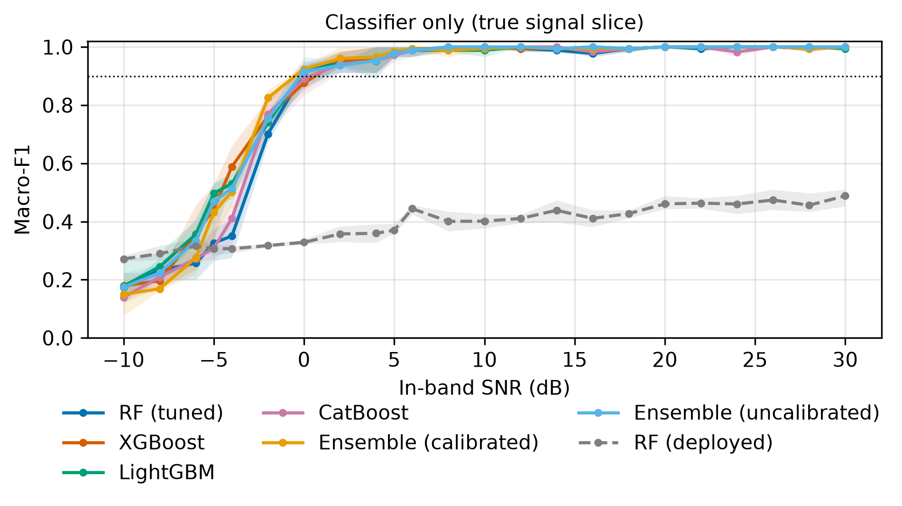

*Figure 1. Classifier-only macro-F1 versus in-band SNR (line: mean of 3 seeds; band: min–max). Dotted line: 90 %.*

Ensemble (calibrated) leads at 0–10 dB; the SNR for 90 % macro-F1 ranges from -0.5 to 0.4 dB across models.

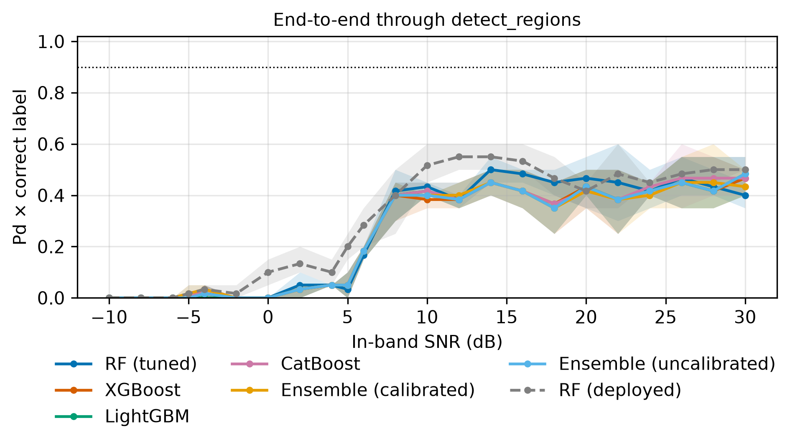

*Figure 2. End-to-end success (detected × correctly labelled) versus in-band SNR, averaged over the signal classes.*

For Ensemble (calibrated) the detector finds half the signals from about 6 dB and 90 % from about 10 dB in-band SNR; below that the end-to-end curve is limited by detection, not by the classifier.

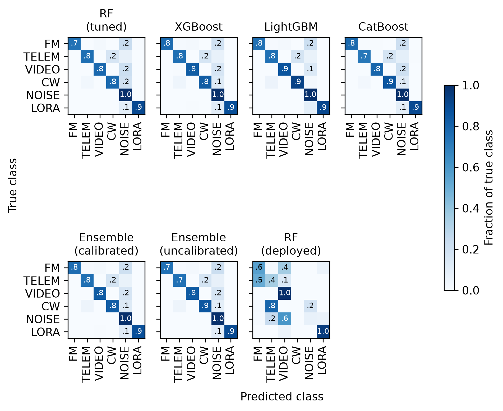

*Figure 3. Normalised confusion matrices on the seed-0 test set (all SNR steps).*

The largest confusion, averaged over the tuned models, is true FM_BROADCAST predicted as NOISE (22% of that class), pooled over all SNR steps.

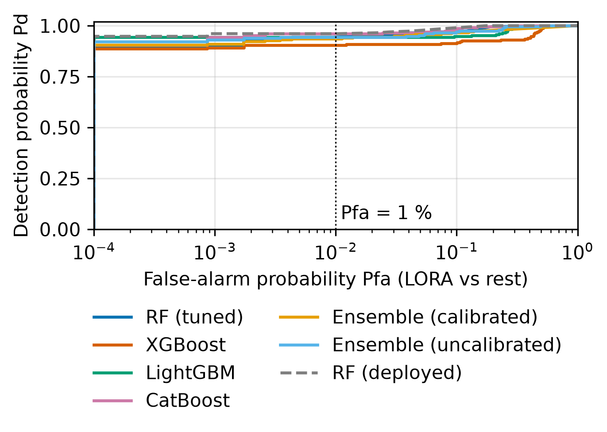

*Figure 4. Pd versus Pfa for LORA vs rest (seed 0); dotted line at Pfa = 1 %.*

Pd at Pfa = 1 %: RF (tuned) 0.926, XGBoost 0.877, LightGBM 0.907, CatBoost 0.928, Ensemble (calibrated) 0.913, Ensemble (uncalibrated) 0.917, RF (deployed) 0.961.

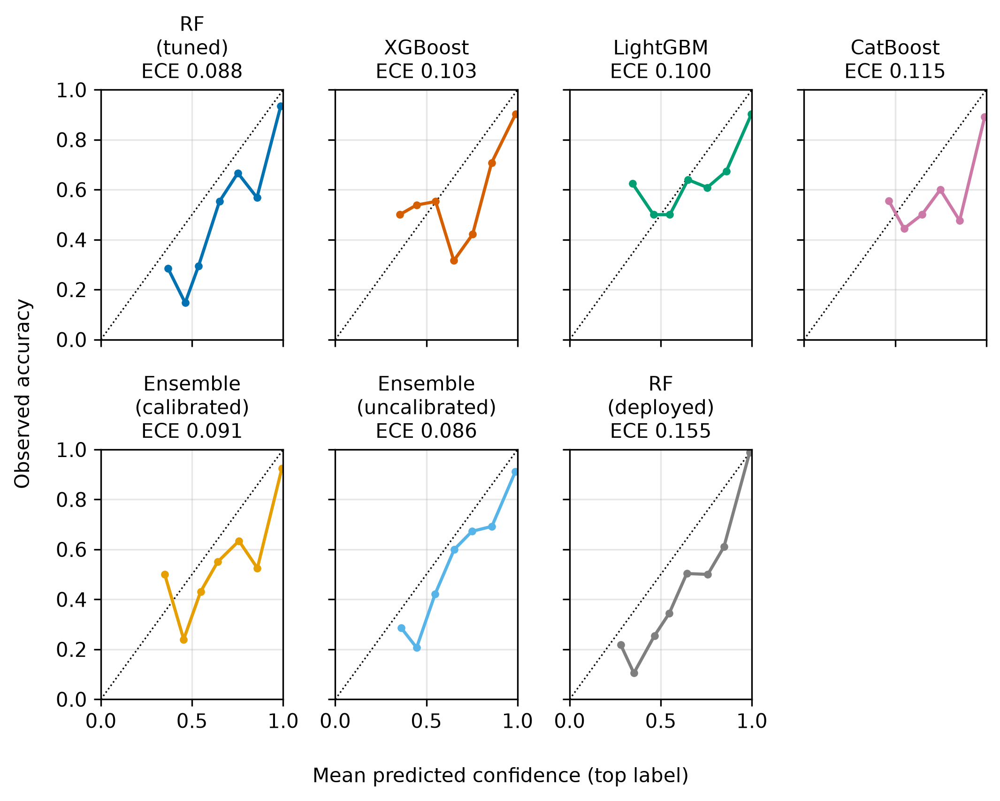

*Figure 5. Reliability diagrams (top-label confidence vs accuracy, seed 0).*

ECE ranges from 0.078 to 0.157.

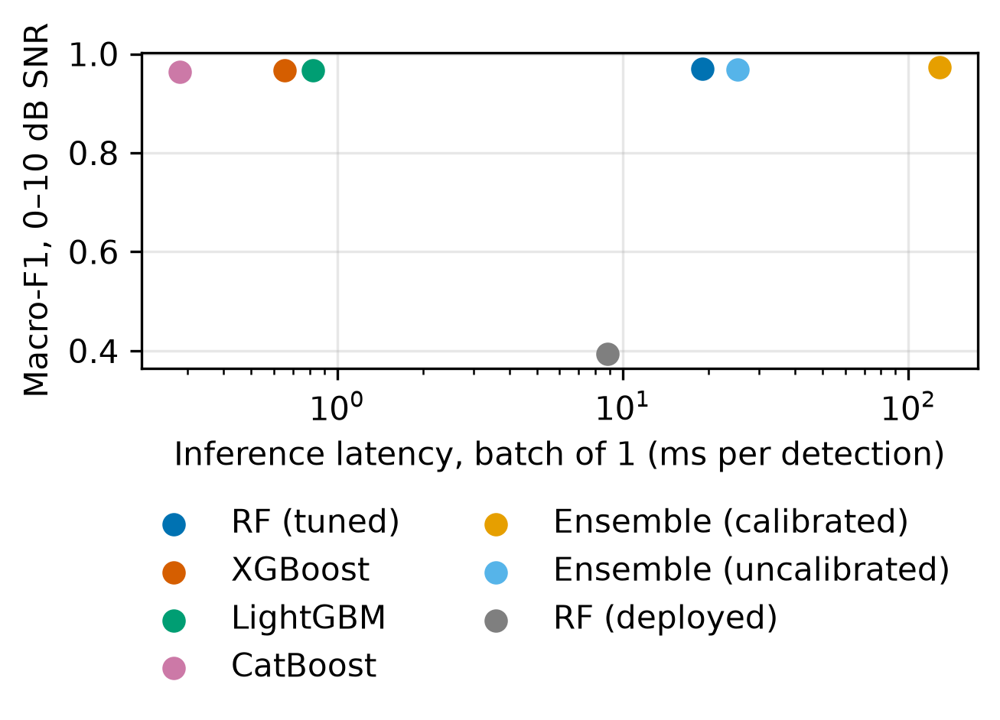

*Figure 6. Inference latency (batch of 1) versus macro-F1 at 0–10 dB SNR.*

Classifier latency ranges from 0.28 to 128.3 ms per detection (batch of 1), all inside the 500 ms block budget.

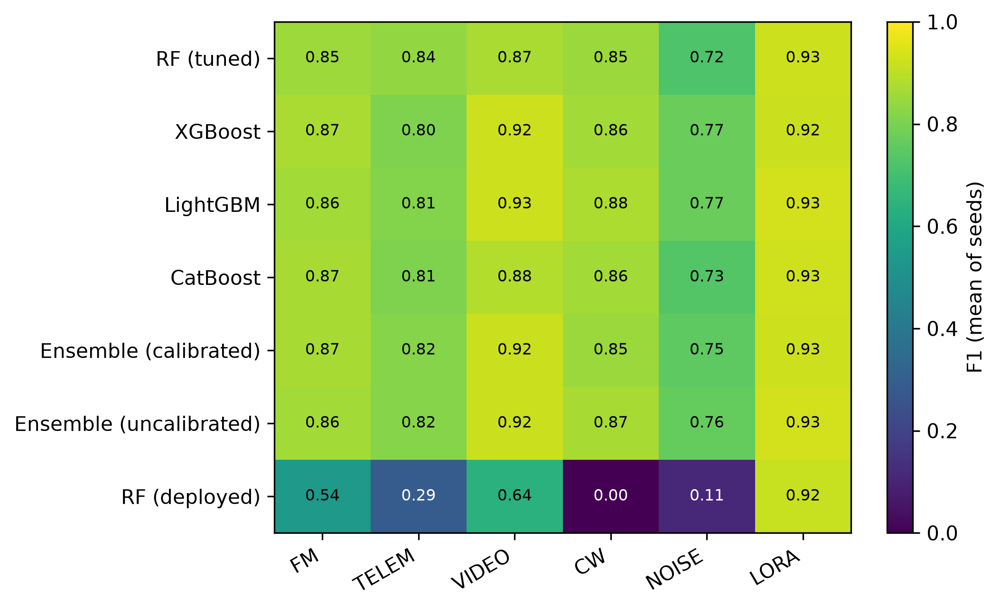

*Figure 7. Per-class F1 (mean of seeds).*

Weakest class per tuned model: NOISE (6 of 6 models).

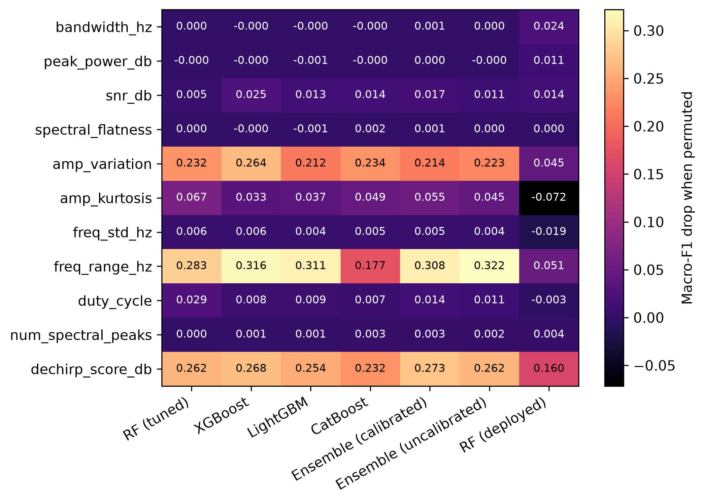

*Figure 8. Permutation importance (macro-F1 drop, seed-0 test set, SNR ≥ 0 dB).*

Most important features on average (macro-F1 drop when permuted): freq_range_hz (0.286), dechirp_score_db (0.259), amp_variation (0.230).

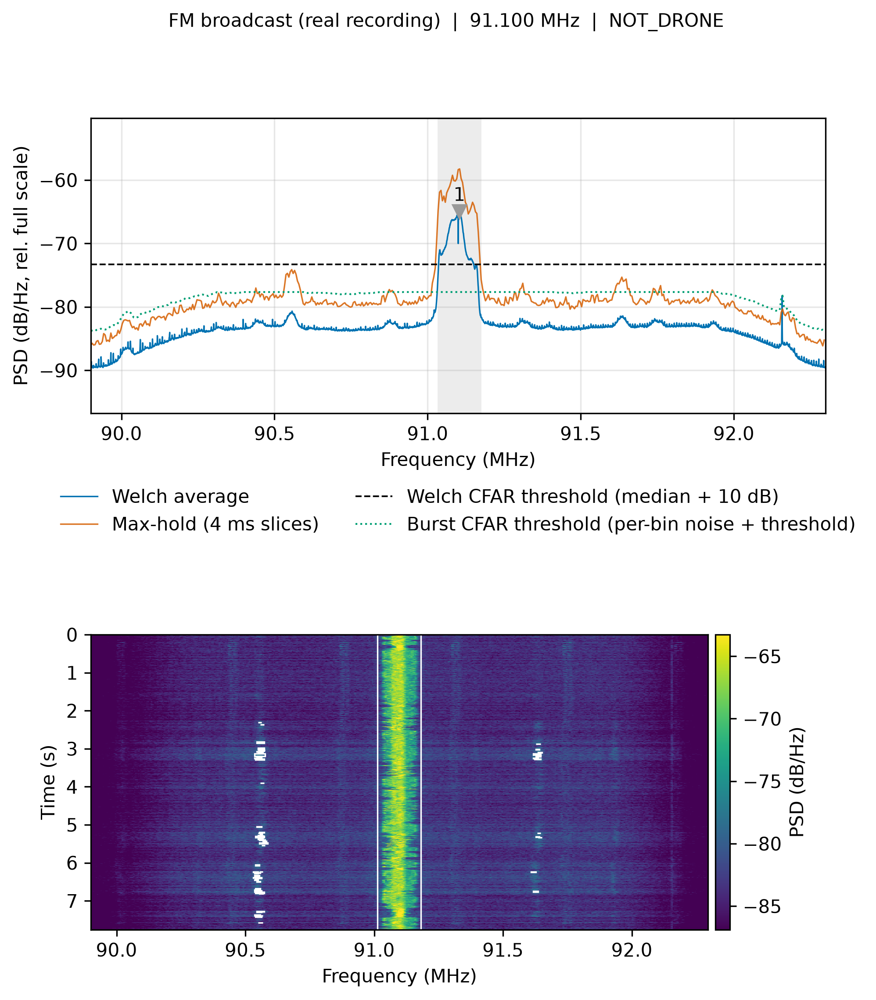

*Figure 10. Scenario 'fm': spectrum (Welch average, max-hold, thresholds, detections) and waterfall with detected bursts boxed.*

Produced by spectrum_report.py with the deployed pipeline.

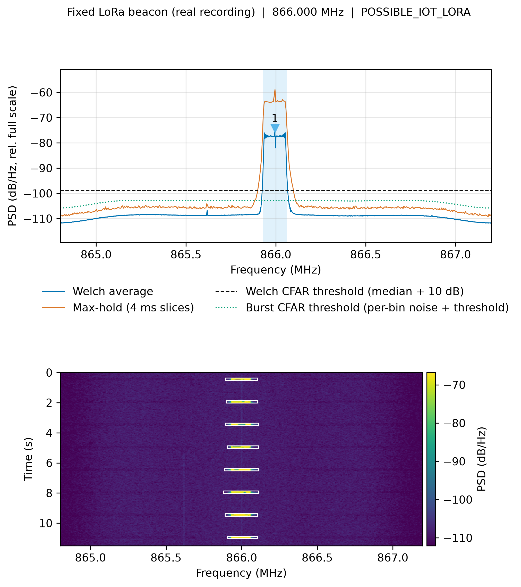

*Figure 11. Scenario 'fixed beacon': spectrum (Welch average, max-hold, thresholds, detections) and waterfall with detected bursts boxed.*

Produced by spectrum_report.py with the deployed pipeline.

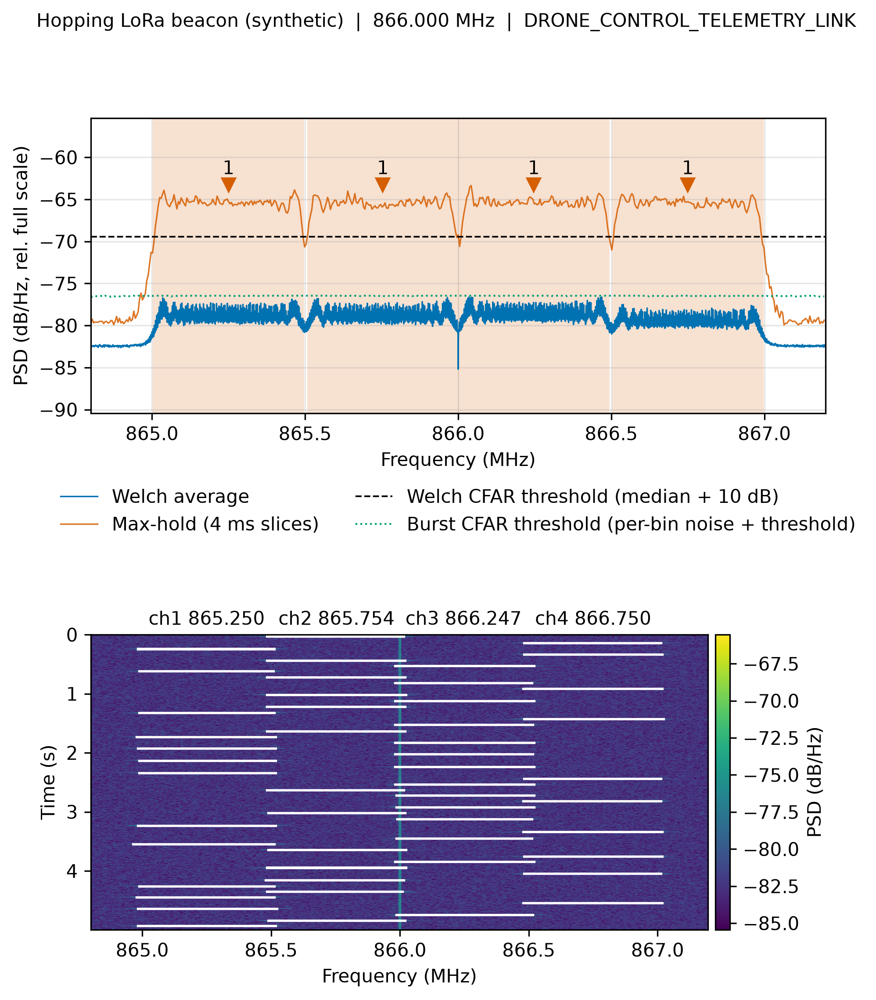

*Figure 12. Scenario 'hopping beacon': spectrum (Welch average, max-hold, thresholds, detections) and waterfall with detected bursts boxed.*

Produced by spectrum_report.py with the deployed pipeline.

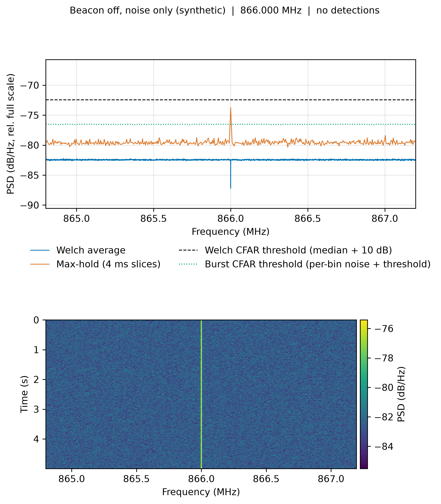

*Figure 13. Scenario 'beacon off': spectrum (Welch average, max-hold, thresholds, detections) and waterfall with detected bursts boxed.*

Produced by spectrum_report.py with the deployed pipeline.

**Table 1. Overall comparison (synthetic test set, -10 to +30 dB; mean ± std over seeds)**

| Model | Macro-F1 | Balanced acc. | Pd @ Pfa=1% (LORA) | SNR for 90% F1 (dB) | Macro-F1 0–10 dB | End-to-end 0–10 dB | Latency b1 (ms/det) | Latency b10 (ms/det) | Size (MB) | Train time (s) |
|---|---|---|---|---|---|---|---|---|---|---|
| RF (tuned) | 0.844 ± 0.006 | 0.835 ± 0.007 | 0.926 ± 0.022 | -0.0626 ± 0.2284 | 0.969 ± 0.009 | 0.164 ± 0.010 | 18.9 | 1.89 | 1.80 | **0.776 ± 0.045** |
| XGBoost | 0.859 ± 0.005 | 0.855 ± 0.007 | 0.877 ± 0.020 | 0.429 ± 0.546 | 0.966 ± 0.010 | 0.157 ± 0.010 | 0.655 | 0.101 | 2.00 | 0.840 ± 0.120 |
| LightGBM | **0.864 ± 0.006** | **0.859 ± 0.006** | 0.907 ± 0.026 | 0.0208 ± 0.6062 | 0.966 ± 0.012 | 0.162 ± 0.009 | 0.824 | 0.233 | 2.83 | 0.844 ± 0.016 |
| CatBoost | 0.847 ± 0.008 | 0.839 ± 0.008 | 0.928 ± 0.024 | 0.347 ± 0.824 | 0.964 ± 0.016 | 0.162 ± 0.009 | **0.280** | **0.0691** | **0.453** | 4.34 ± 0.08 |
| Ensemble (calibrated) | 0.856 ± 0.004 | 0.849 ± 0.006 | 0.913 ± 0.018 | **-0.511 ± 0.266** | **0.974 ± 0.009** | 0.160 ± 0.012 | 128 | 5.85 | 31.5 | 11.0 ± 0.0 |
| Ensemble (uncalibrated) | 0.861 ± 0.006 | 0.856 ± 0.007 | 0.917 ± 0.021 | 0.0309 ± 0.6137 | 0.968 ± 0.011 | 0.160 ± 0.012 | 25.2 | 3.26 | 6.64 | 2.32 ± 0.02 |
| RF (deployed) | 0.416 ± 0.003 | 0.491 ± 0.004 | **0.961 ± 0.004** | n/a | 0.394 ± 0.006 | **0.248 ± 0.020** | 8.83 | 0.877 | 0.502 | n/a |

**Table 2. Per-class precision / recall / F1 (best per class in bold)**

| Class | Model | Precision | Recall | F1 |
|---|---|---|---|---|
| FM_BROADCAST | RF (tuned) | 0.998 ± 0.003 | 0.746 ± 0.004 | 0.854 ± 0.003 |
| FM_BROADCAST | XGBoost | 0.994 ± 0.005 | **0.777 ± 0.013** | **0.872 ± 0.009** |
| FM_BROADCAST | LightGBM | 0.998 ± 0.003 | 0.757 ± 0.004 | 0.861 ± 0.003 |
| FM_BROADCAST | CatBoost | **1.00 ± 0.00** | 0.767 ± 0.009 | 0.868 ± 0.006 |
| FM_BROADCAST | Ensemble (calibrated) | 0.998 ± 0.003 | 0.772 ± 0.005 | 0.871 ± 0.003 |
| FM_BROADCAST | Ensemble (uncalibrated) | 0.998 ± 0.003 | 0.758 ± 0.007 | 0.862 ± 0.005 |
| FM_BROADCAST | RF (deployed) | 0.511 ± 0.002 | 0.564 ± 0.002 | 0.536 ± 0.002 |
| DRONE_TELEMETRY | RF (tuned) | 0.970 ± 0.012 | **0.736 ± 0.035** | **0.836 ± 0.019** |
| DRONE_TELEMETRY | XGBoost | 0.932 ± 0.037 | 0.710 ± 0.036 | 0.805 ± 0.020 |
| DRONE_TELEMETRY | LightGBM | 0.959 ± 0.028 | 0.710 ± 0.038 | 0.815 ± 0.018 |
| DRONE_TELEMETRY | CatBoost | **0.972 ± 0.009** | 0.693 ± 0.028 | 0.808 ± 0.018 |
| DRONE_TELEMETRY | Ensemble (calibrated) | 0.939 ± 0.014 | 0.728 ± 0.022 | 0.819 ± 0.011 |
| DRONE_TELEMETRY | Ensemble (uncalibrated) | 0.962 ± 0.024 | 0.712 ± 0.032 | 0.817 ± 0.014 |
| DRONE_TELEMETRY | RF (deployed) | 0.249 ± 0.011 | 0.355 ± 0.028 | 0.293 ± 0.017 |
| DRONE_VIDEO | RF (tuned) | 0.991 ± 0.009 | 0.780 ± 0.002 | 0.873 ± 0.002 |
| DRONE_VIDEO | XGBoost | 0.982 ± 0.007 | 0.870 ± 0.028 | 0.922 ± 0.018 |
| DRONE_VIDEO | LightGBM | 0.982 ± 0.006 | 0.875 ± 0.012 | **0.926 ± 0.010** |
| DRONE_VIDEO | CatBoost | **0.996 ± 0.003** | 0.793 ± 0.018 | 0.883 ± 0.010 |
| DRONE_VIDEO | Ensemble (calibrated) | 0.988 ± 0.010 | 0.862 ± 0.021 | 0.921 ± 0.017 |
| DRONE_VIDEO | Ensemble (uncalibrated) | 0.983 ± 0.005 | 0.867 ± 0.024 | 0.921 ± 0.015 |
| DRONE_VIDEO | RF (deployed) | 0.469 ± 0.012 | **1.00 ± 0.00** | 0.638 ± 0.011 |
| INTERFERENCE | RF (tuned) | 0.821 ± 0.032 | 0.881 ± 0.077 | 0.848 ± 0.043 |
| INTERFERENCE | XGBoost | 0.816 ± 0.028 | 0.917 ± 0.062 | 0.862 ± 0.028 |
| INTERFERENCE | LightGBM | 0.821 ± 0.038 | **0.941 ± 0.012** | **0.876 ± 0.024** |
| INTERFERENCE | CatBoost | 0.817 ± 0.033 | 0.914 ± 0.048 | 0.862 ± 0.033 |
| INTERFERENCE | Ensemble (calibrated) | **0.827 ± 0.029** | 0.872 ± 0.036 | 0.848 ± 0.018 |
| INTERFERENCE | Ensemble (uncalibrated) | 0.823 ± 0.035 | 0.926 ± 0.053 | 0.870 ± 0.030 |
| INTERFERENCE | RF (deployed) | 0 ± 0 | 0 ± 0 | 0 ± 0 |
| NOISE | RF (tuned) | 0.568 ± 0.015 | **1.00 ± 0.00** | 0.724 ± 0.012 |
| NOISE | XGBoost | 0.630 ± 0.026 | 0.999 ± 0.002 | 0.772 ± 0.019 |
| NOISE | LightGBM | **0.630 ± 0.020** | 0.999 ± 0.002 | **0.773 ± 0.015** |
| NOISE | CatBoost | 0.577 ± 0.002 | 0.999 ± 0.002 | 0.731 ± 0.002 |
| NOISE | Ensemble (calibrated) | 0.603 ± 0.021 | 0.999 ± 0.002 | 0.752 ± 0.017 |
| NOISE | Ensemble (uncalibrated) | 0.618 ± 0.019 | 0.999 ± 0.002 | 0.763 ± 0.014 |
| NOISE | RF (deployed) | 0.279 ± 0.007 | 0.0696 ± 0.0035 | 0.111 ± 0.005 |
| LORA | RF (tuned) | 0.995 ± 0.004 | 0.865 ± 0.033 | 0.925 ± 0.018 |
| LORA | XGBoost | 0.998 ± 0.002 | 0.855 ± 0.025 | 0.921 ± 0.015 |
| LORA | LightGBM | **0.998 ± 0.002** | 0.874 ± 0.026 | **0.932 ± 0.015** |
| LORA | CatBoost | 0.997 ± 0.002 | 0.871 ± 0.025 | 0.929 ± 0.013 |
| LORA | Ensemble (calibrated) | **0.998 ± 0.002** | 0.862 ± 0.018 | 0.925 ± 0.010 |
| LORA | Ensemble (uncalibrated) | **0.998 ± 0.002** | 0.872 ± 0.017 | 0.931 ± 0.010 |
| LORA | RF (deployed) | 0.879 ± 0.007 | **0.955 ± 0.004** | 0.915 ± 0.005 |

**Table 3. Classifier-only macro-F1 at selected in-band SNRs**

| Model | -5 dB | 0 dB | 5 dB | 10 dB | 20 dB |
|---|---|---|---|---|---|
| RF (tuned) | 0.326 ± 0.046 | 0.914 ± 0.017 | 0.978 ± 0.016 | **1.00 ± 0.00** | **1.00 ± 0.00** |
| XGBoost | 0.443 ± 0.083 | 0.876 ± 0.029 | 0.978 ± 0.016 | **1.00 ± 0.00** | **1.00 ± 0.00** |
| LightGBM | **0.497 ± 0.031** | 0.915 ± 0.038 | 0.978 ± 0.016 | 0.989 ± 0.016 | **1.00 ± 0.00** |
| CatBoost | 0.309 ± 0.043 | 0.890 ± 0.047 | 0.972 ± 0.021 | 0.994 ± 0.008 | **1.00 ± 0.00** |
| Ensemble (calibrated) | 0.431 ± 0.065 | **0.924 ± 0.011** | **0.983 ± 0.014** | 0.994 ± 0.008 | **1.00 ± 0.00** |
| Ensemble (uncalibrated) | 0.469 ± 0.067 | 0.915 ± 0.043 | 0.978 ± 0.016 | **1.00 ± 0.00** | **1.00 ± 0.00** |
| RF (deployed) | 0.307 ± 0.016 | 0.329 ± 0.008 | 0.370 ± 0.016 | 0.401 ± 0.020 | 0.461 ± 0.019 |

**Table 4. Tuned hyperparameters (30-trial random search, 5-fold stratified CV on the seed-0 training set)**

| Model | Best hyperparameters | CV macro-F1 | Tuning time (s) |
|---|---|---|---|
| RF (tuned) | max_depth=24, max_features=0.500, min_samples_leaf=1, n_estimators=228 | 0.990 ± 0.008 | 40.6 |
| XGBoost | colsample_bytree=0.912, learning_rate=0.0276, max_depth=3, min_child_weight=2, n_estimators=365, reg_lambda=1.19, subsample=0.903 | 0.988 ± 0.006 | 18.0 |
| LightGBM | colsample_bytree=0.933, learning_rate=0.165, min_child_samples=5, n_estimators=438, num_leaves=43, reg_lambda=3.97, subsample=0.785, subsample_freq=1 | 0.989 ± 0.006 | 24.6 |
| CatBoost | depth=4, iterations=455, l2_leaf_reg=6.00, learning_rate=0.267 | **0.990 ± 0.008** | 703 |
| Ensemble (calibrated) | members=xgb + lgbm + rf (tuned params), calibration=isotonic, 5-fold, voting=soft | 0.989 ± 0.009 | 12.9 |
| Ensemble (uncalibrated) | members=xgb + lgbm + rf (tuned params), calibration=none, voting=soft | 0.989 ± 0.008 | **2.74** |

**Table 5. Probability quality and end-to-end false alarms**

| Model | Log loss | Brier score | ECE | Noise captures with a non-NOISE label |
|---|---|---|---|---|
| RF (tuned) | 0.747 ± 0.088 | 0.246 ± 0.002 | **0.0780 ± 0.0070** | **0 ± 0** |
| XGBoost | 0.614 ± 0.025 | 0.246 ± 0.012 | 0.0896 ± 0.0104 | **0 ± 0** |
| LightGBM | 0.751 ± 0.018 | 0.243 ± 0.006 | 0.106 ± 0.005 | **0 ± 0** |
| CatBoost | 0.690 ± 0.034 | 0.276 ± 0.013 | 0.119 ± 0.009 | **0 ± 0** |
| Ensemble (calibrated) | 1.31 ± 0.33 | 0.238 ± 0.003 | 0.0820 ± 0.0065 | **0 ± 0** |
| Ensemble (uncalibrated) | **0.527 ± 0.008** | **0.234 ± 0.005** | 0.0813 ± 0.0040 | **0 ± 0** |
| RF (deployed) | 5.33 ± 0.12 | 0.670 ± 0.005 | 0.157 ± 0.004 | **0 ± 0** |

## Key findings

- Overall macro-F1 (all SNRs, -10 to +30 dB): best LightGBM 0.864; range across tuned models 0.844–0.864. The deployed RF scores 0.416 on the same test set.
- At 0–10 dB SNR the best model is Ensemble (calibrated) (macro-F1 0.974); the spread across tuned models there is 0.009, so the choice of model matters little at these SNRs.
- SNR needed for 90 % macro-F1: RF (tuned) -0.1 dB, XGBoost 0.4 dB, LightGBM 0.0 dB, CatBoost 0.3 dB, Ensemble (calibrated) -0.5 dB, Ensemble (uncalibrated) 0.0 dB, RF (deployed) not reached.
- Calibration: the calibrated ensemble has ECE 0.082 and log loss 1.312 versus 0.081 and 0.527 uncalibrated — calibration improves neither here.
- Latency per detection (batch of 1): fastest CatBoost 0.28 ms, slowest Ensemble (calibrated) 128.32 ms; all are far below the 500 ms block budget, where feature extraction and detection dominate.
- At 0 dB in-band SNR, Ensemble (calibrated) reaches macro-F1 0.924 when given the true signal slice, but only 0.000 end-to-end (detected and correctly labelled); the detector finds 28% of signals at that SNR, so detection, not classification, limits low-SNR performance.

## Limitations

- All training and test data are synthetic. Real emitters (multipath, oscillator drift, front-end non-linearity, other users of 865–867 MHz) are not represented, so absolute scores overstate real performance (domain gap).
- No labelled real recordings were found in rf_dataset/, so there is no real-data evaluation.
- End-to-end captures contain one signal each; crowded bands with overlapping emitters are not tested.
- Latency is measured on this machine for the classifier only; detection and feature extraction (tens to hundreds of ms per block) dominate the pipeline's time.
- The deployed RF was trained by train_rf_classifier.py on a different synthetic generator (whole-band SNR for most classes), so it is a reference, not a tuned competitor.

## Recommended model

CatBoost (--model cat): macro-F1 0.964 at 0–10 dB SNR (best 0.974; models within 0.01 of the best: RF (tuned), XGBoost, LightGBM, CatBoost, Ensemble (calibrated), Ensemble (uncalibrated)), 0.28 ms per detection, far inside the 500 ms block budget. Chosen as the fastest of the models within 0.01 macro-F1 of the best.

The default pipeline stays on the deployed RF (--model rf); other models load with --model rf_tuned/xgb/lgbm/cat/ensemble.
